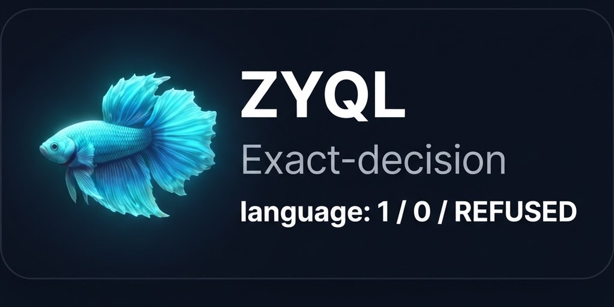

<p align="center"></p>

# ZEPHIRUM

*The quantum programming language with receipts.*


ZEPHIRUM is a small quantum programming language. ZYQL is its decision algorithm:
every computational decision is trivalent - `1` (permitted), `0` (forbidden),
`REFUSED` (input-dependent or insufficient confidence) - and carries a sealed
receipt (SHA3-256 integrity seal, hash proves content integrity, not authorship).
ML-DSA-44 / FIPS 204 signatures are a DECLARED ROADMAP item — to be implemented
with an accredited module and HSM-held keys, never hand-rolled (see docs/receipts.md).

Decisions are produced by Deutsch-Jozsa interference, one oracle call, with a
declared noise band (+-0.15). Nothing executes silently: unknown syntax raises
an explicit error. Simulation mode is labeled as simulation.

```
circuit bell {
  qubit[2] q;
  H q[0];
  CNOT q[0] -> q[1];
}
```

Verified on real hardware (IBM Heron `ibm_fez`, cited as test laboratory with
verifiable job IDs; no endorsement claimed):
- Constant purpose: measured p(000)=0.9844 (job db6ded84qg6s73c4jvug)
- S3 qutrit miniature: fusion channels (qutrit-in-qubits) + braiding non-commutativity,
  noiseless with exact-zero deviation and on hardware: ch2=98.1% (RS) vs ch1=95.8% (SR),
  full ZYQL battery 3/3 PASS on `ibm_fez` (jobs `dbbueufi0auc73dtp7og`, `dbbugbk24mrc73cif420`;
  Z-QEA receipt sealed, see `experiments/`)
- Balanced purpose: p(000)=0.0000, orthogonal outcome 93.9%
- Same-task confrontation vs textbook Qiskit (job db6dklcvf2bc73d122t0):
  Zephyron transpiles to depth 2 / 0 two-qubit gates vs depth 10 / 3 CZ

## Quickstart

```bash
pip install -e .
python -c "from zyql_quantum_gate import ZYQLQuantumGate; \
g = ZYQLQuantumGate(3, lambda x: 1); print(g.run_quantum())"
```

(No install? `PYTHONPATH=src` works too. The old `from src.zyql_quantum_gate`
quickstart was broken — fixed in v1.6.0, see docs/AUDIT.md.)

## Layout

- `src/` - kernel (state-vector), OpenQASM 3 transpiler, trivalent gate,
  quantum types (no-cloning enforced), neural RAG layer
- `examples/` - `bell.zph`, `grover.zph`, `dj_constant.zph`
- `tests/` - canonical rational test battery
- `docs/` - language reference, receipt specification

## Honest scope

This repository contains the language heart only: kernel, types, gate, receipts.
It does not contain, and will never contain, the Zephirum OS distribution,
bootloader, installer, or activation keys. Simulations are labeled as
simulations; without error correction, useful executions are bounded well
under 20 qubits.

## Citation

See `CITATION.cff`. Software deposit: Zenodo concept DOI 10.5281/zenodo.23302046
(code MIT, companion thesis CC BY-NC-ND 4.0), (c) Serena Solutions.

## License

MIT - see [LICENSE](LICENSE).
