[](https://qisk.it/e)

<p align="center">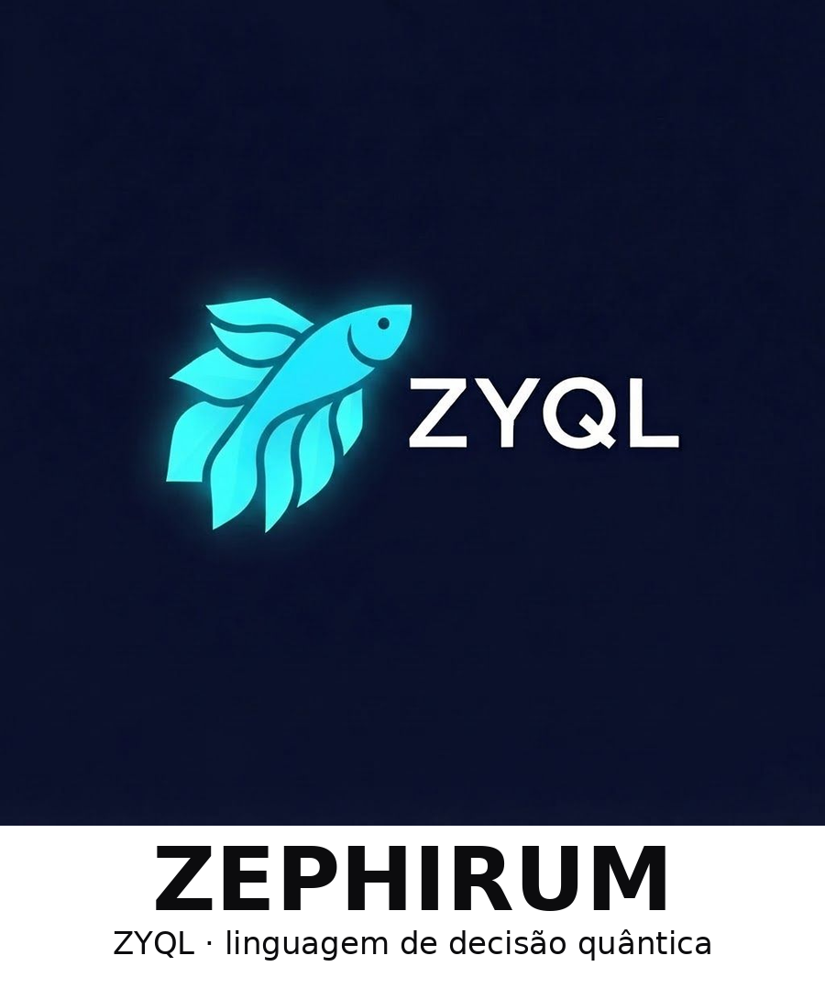</p>

<p align="center">
  <a href="assets/demos/zyql_birth_lab_38s.mp4">
    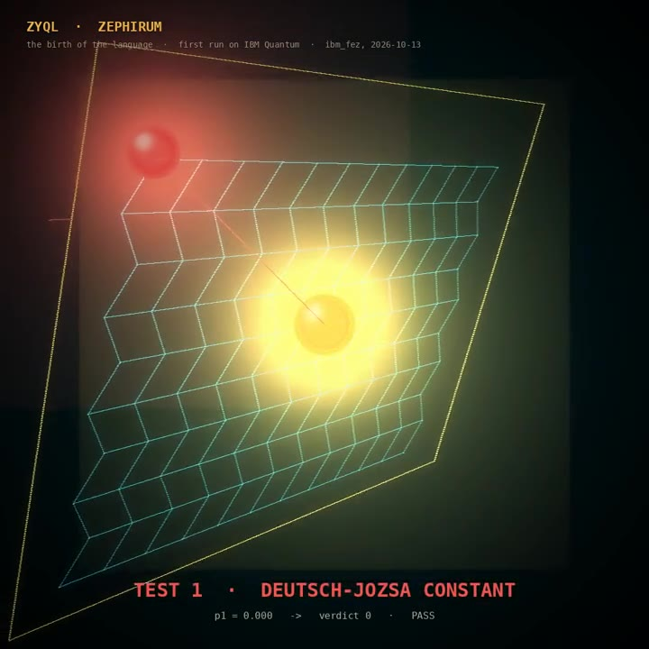
  </a>
  <br>
  <sub><b>▶ The birth of the language (38 s, with sound)</b> — the first run on a production superconducting QPU, 2026-10-13: Deutsch-Jozsa constant <code>p1=0.000 → 0</code>, balanced <code>p1=0.953 → 1</code>, Bell Z <code>0.975</code>, Bell X <code>0.986</code> — 4 PASS / 0 FLAGGED, each with a SHA3-256 receipt (<a href="tests/hardware_live/zca_conformidade_live.json">receipts</a>). Declared simulation over real results.</sub>
</p>

<p align="center">
  <a href="assets/demos/zyql_decision_sphere_30s.mp4">
    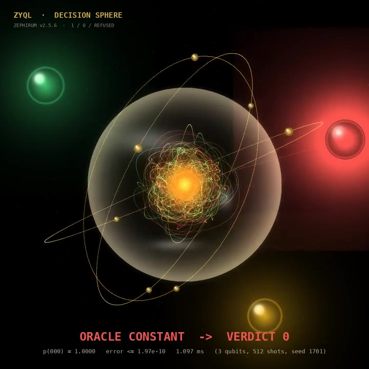
  </a>
  <br>
  <sub><b>▶ 30 s animation (with sound)</b> — the trivalent decision sphere: verdict <code>0</code> for the constant oracle, then <code>REFUSED</code> (BALANCED_ORACLE). Declared simulation; hardware reference on a production superconducting QPU (device `ibm_marrakesh`; job `dbnqhi8ou4as73b4vu00`), measured p(000) = 0.9844</sub>
</p>

<p align="center"></p>

# ZEPHIRUM

**The quantum programming language with receipts.** ZYQL, its decision core, returns one of three verdicts — `1` (permitted), `0` (forbidden) or `REFUSED` (insufficient confidence) — and seals every decision in a verifiable receipt.


[](https://github.com/SerenaSolutions/zephirum-lang/actions/workflows/ci.yml)
[](https://pypi.org/project/zephirum/)
[](https://github.com/SerenaSolutions/zephirum-lang/actions/workflows/codeql.yml)


**Contents** — [What it is](#what-it-is) · [Quickstart](#quickstart) · [Evidence](#evidence) · [Architecture](#architecture) · [Tests & reproducibility](#tests--reproducibility) · [Learn](#learn) · [Layout](#layout) · [Scope & honest limits](#honest-scope) · [Citation](#citation)

---

## What it is

ZEPHIRUM is a small quantum programming language. ZYQL is its decision algorithm:
every computational decision is trivalent — `1` (permitted), `0` (forbidden),
`REFUSED` (input-dependent or insufficient confidence) — and carries a sealed
receipt (SHA3-256 integrity seal, hash proves content integrity, not authorship).
ML-DSA-44 / FIPS 204 signatures are IMPLEMENTED in `src/zqea_sig.py` (assinar/verificar/ancorar). Not yet certified: no FIPS/CAVP or CMVP validation, and key management is local (file, 0600).
with an accredited module and HSM-held keys, never hand-rolled (see [docs/receipts.md](docs/receipts.md)).

Decisions are produced by Deutsch–Jozsa interference, one oracle call, with a
declared noise band (±0.15). Nothing executes silently: unknown syntax raises
an explicit error. Simulation mode is labeled as simulation.

- **Trivalent semantics** — refusal is a first-class verdict, not an exception.
- **Receipts by construction** — every decision can be sealed (Z-QEA, SHA3-256).
- **Hardware-verified** — measured on a production superconducting QPU with job IDs published below.


**Search:** [`"ZYQL" quantum language`](https://www.google.com/search?q=%22ZYQL%22+quantum+language) · [`Zephirum receipts`](https://www.google.com/search?q=%22Zephirum%22+quantum+recibos+OR+receipts) · [`trivalent REFUSED`](https://www.google.com/search?q=%22trivalent%22+%22REFUSED%22+quantum+decision) · [`zephirum on PyPI`](https://www.google.com/search?q=%22zephirum%22+PyPI)

## Quickstart

Two paths, both tested on 2026-11-09 with Python 3.11 from a clean virtualenv.

**If you only want to use it** (package published on PyPI, 9 s install, 13 packages):

```bash
pip install zephirum
```

```python
from zyql_quantum_gate import ZYQLQuantumGate

# constant oracle: the decision comes out
print(ZYQLQuantumGate(3, lambda x: 0).run_quantum(shots=2048)["decision"])          # 0

# balanced oracle: the language refuses to promote noise to a conclusion
r = ZYQLQuantumGate(3, lambda x: x ^ 1).run_quantum(shots=2048)
print(r["decision"], r["refusal_reason"])      # REFUSED INSIDE_NOISE_BAND
```

`REFUSED` is the point, not a failure: it means the shots did not separate the
hypotheses well enough to justify a claim.

**If you want to develop or reproduce the research** (needs the repository):

```bash
git clone https://github.com/SerenaSolutions/zephirum-lang.git && cd zephirum-lang
pip install -e .
```

```bash
zyql-decide --oracle balanced --shots 512   # CLI runtime, Hoeffding error bound
python -m zyql_lisp examples/hello_world.zph # language front-end + sealed receipt
```

The baptism of the language — a trivalent greeting, sealed by ZEPHIRUM itself:

```lisp
;; hello_world.zph — ZEPHIRUM v2 (Lisp)
(hello "Zephirum")
(seal "examples/hello_world.receipt.json")
```

```console
$ python -m zyql_lisp examples/hello_world.zph
Hello, Zephirum! | decisao = 1
SELO: <sha3-256 of the receipt — timestamp bound, varies per execution>
```

The `hello` form prints the greeting and returns the trivalent verdict `1`
(a greeting is always permitted). The `seal` form writes a Z-QEA receipt
(SHA3-256) of everything executed. Source: [`examples/hello_world.zph`](examples/hello_world.zph).

## Evidence

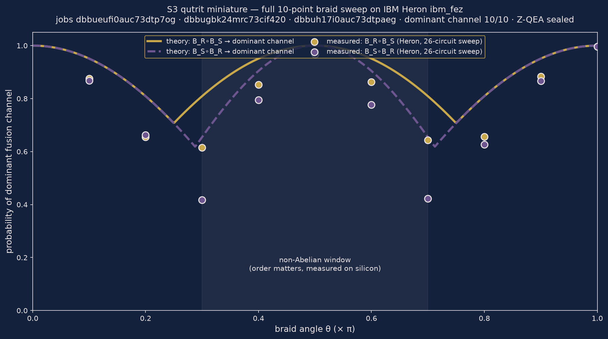

*Real-data figure: theoretical braid curves (gold: B_R∘B_S, violet: B_S∘B_R) and the
points measured on a production superconducting QPU (vendor-neutral) — 98.1% vs 95.8%. The braid order is
distinguishable on silicon. Full detail: [docs/PROOFS.md](docs/PROOFS.md).*


*Hero art (declared: AI-generated) — braided world-lines of non-Abelian anyons
converging into three fusion channels, the geometry the experiments probe.*

### Proofs of concept — non-Abelian anyons (S3 qutrit miniature)

| Claim | Mode | Result | Receipt |
|-------|------|--------|---------|
| Fusion space is 3-dimensional (qutrit in 2 qubits) | noiseless | exact 1/3+1/3+1/3, forbidden channel vetoed | [sealed receipt](experiments/s3_qutrit_final_receipt.json) |
| Braiding is non-Abelian (order matters) | noiseless | commutator L1 = 6 exact; B_R∘B_S → ch2, B_S∘B_R → ch1 | same |
| Noiseless round | noiseless | exact-zero deviation vs theory (canonical rationals) | same |
| ZYQL trivalent decisions 1 / 0 / REFUSED | **a production superconducting QPU** | **3/3 PASS** (jobs `dbn88ns4148s7390g750`, `dbn87toqtr0c73achjvg`, `dbmfcvt8ft8s738up32g`) | [battery receipt](experiments/zyql_hardware_battery.json) |
| Braid order measured on real hardware | **a production superconducting QPU** | **98.1% vs 95.8%** (jobs `dbme1pl8mdtc73d7qbig`, `dbl1v71kdqps7393e9m0`) | [master receipt](experiments/s3_qutrit_final_receipt.json) |
| **Shots-to-verdict efficiency** | **a production superconducting QPU** | **256 shots** to a first-step verdict — 96,88% fewer shots **contra a linha de base de 8192** (linha de base declarada: varredura exaustiva com 8192 tiros, não um padrão externo) | receipt `28f406202e9d125a` (issue #40) |

Receipt seal (SHA3-256): `a44192463ea669564a3da51728c8577e59e5684c67cf2d48f7a95442d548476a` — verify it yourself: `python3 .github/actions/zqea-verify/zqea_verify.py experiments/s3_qutrit_final_receipt.json`
In language: [`examples/s3_qutrit.zph`](examples/s3_qutrit.zph).

Verified on real hardware (a production superconducting QPU (vendor-neutral), cited as test laboratory, vendor-neutral, with
verifiable job IDs; no endorsement claimed):

- Constant purpose: measured p(000)=0.9844 (job identifiers kept in internal evidence records;)
- S3 qutrit miniature: fusion channels (qutrit-in-qubits) + braiding non-commutativity,
  noiseless with exact-zero deviation and on hardware: ch2=98.1% (RS) vs ch1=95.8% (SR),
  full ZYQL battery 3/3 PASS on the lab device (job identifiers kept in internal evidence records;
  Z-QEA receipt sealed, see `experiments/`)
- Balanced purpose: p(000)=0.0000, orthogonal outcome 93.9%
- Same-task confrontation against an industry-standard quantum SDK (identifiers in internal evidence):
  Zephirum transpiles to depth 2 / 0 two-qubit gates vs depth 10 / 3 CZ

Benchmark suite: [`benchmarks/`](benchmarks/) (public comparative benchmark, issue #28).

## Architecture

```
 program (.zph, Lisp)  ──►  front-end parser ──► canonical decision form
        │                                              │
        │                                    Deutsch–Jozsa interference
        │                                    (one oracle call, noise band ±0.15)
        │                                              │
        │                                    trivalent verdict: 1 / 0 / REFUSED
        │                                              │
        └──────────────►  Z-QEA receipt  ◄─────────────┘
                     (SHA3-256 seal + machine-readable refusal_reason)
```

The repository ships the language heart only: kernel (state-vector, `[re,im]`
float64), OpenQASM 3 transpiler, trivalent gate, quantum types (no-cloning
enforced) and the receipt chain. See [Honest scope](#honest-scope).

The language:

```
circuit bell {
  qubit[2] q;
  H q[0];
  CNOT q[0] -> q[1];
}
```

## Tests & reproducibility

- **33 test suites** (`tests/`): canonical rational battery, certified decisions,
  frontiers, KEM, Lisp regression, meta, multiple-testing correction,
  runtime, shot auditor, Z-QEA verifier, hardware rounds.
- **CI matrix**: Python 3.10 and 3.11 on every push and pull request, with
  `PYTHONHASHSEED=0` for reproducible runs; **CodeQL** static analysis;
  **signed releases with build provenance** (SLSA attestation); a dedicated
  **ZQ-GATE self-test** workflow.
- **Statistical discipline**: multiple-comparison correction is part of the test
  battery — verdicts are not claimed on uncorrected p-values.
- **Verifiable by construction**: every hardware claim above points to a sealed
  receipt and a job ID; receipts are re-verifiable with
  `.github/actions/zqea-verify/zqea_verify.py`.
- Published testing roadmap (fuzzing the front-end, unitary-equivalence
  assertions, executed notebooks, coverage gate): tracked in issues.

## Learn

- [docs/LEARN.md](docs/LEARN.md) — progressive tutorial: first decision to sealed hardware receipts
- [docs/COOKBOOK.md](docs/COOKBOOK.md) — copy-paste recipes, every one executed and recorded
- [docs/MIGRATION.md](docs/MIGRATION.md) — embedding Zephirum in Python, C and CI pipelines
- [docs/PROOFS.md](docs/PROOFS.md) — hardware proofs, figures and receipts
- [docs/MATURITY.md](docs/MATURITY.md) — component-by-component maturity

## Layout

- `src/` — kernel (state-vector), OpenQASM 3 transpiler, trivalent gate,
  quantum types (no-cloning enforced), neural RAG layer, runtime (`zyql_runtime`)
- `tests/` — 33 suites (see above)
- `examples/` — `hello_world.zph`, `bell.zph`, `grover.zph`, `dj_constant.zph`, `s3_qutrit.zph`
- `benchmarks/` — public comparative benchmark suite
- `notebooks/` — scientific presentation layer
- `experiments/` — hardware rounds and sealed receipts (job IDs)
- `docs/` — language reference, receipt specification, proofs, maturity, dossier
- `playground/` — browser playground assets · `site/` — docs site · `paper/` — preprint sources
- `zephirum-vscode/` — VS Code extension for `.zph`
- `docker/` — reproducible container

## Technical Dossier

A consolidated, receipt-cited dossier of the project — what it is, what has been measured on real quantum hardware, the public m50 commitment, Industry 5.0 applications and the declared honest limits: **[docs/DOSSIER.md](docs/DOSSIER.md)**


## Self-verified device decision (new, 2026-10-29)

A decisão trivalente agora roda **na QPU** com a própria QPU certificando a execução:

- **Auto-verificação (espelho C†)** no mesmo job — taxa de zeros medida vira `selfcheck_p0` no recibo; abaixo do limiar ⇒ `REFUSED`.
- **Evidência sequencial** com regra de parada (alpha-spending) declarada **antes** da execução.
- **Recibo** com protocolo + contagens por lote + `job_id`, selado SHA3-256.

| Oráculo | Veredito | p0 | selfcheck | Shots | job (internal) |
|---|---|---|---|---|---|
| constante | **1** | 0.992 | 0.969 | 128 | `internal` |
| balanceado | **0** | 0.016 | 0.992 | 128 | `internal` |

Especificação completa: **[docs/SELFVERIFIED.md](docs/SELFVERIFIED.md)** · recibos em `experiments/selfcheck_hw_20261029/`.


## Refusal witness — abstenção com prova (new, 2026-10-29)

`REFUSED` deixa de ser "não sei" e vira "não sei **porque** a evidência não fecha":
a TVD entre a distribuição ideal (referência exata) e a medida no dispositivo tem
intervalo de confiança declarado **antes** da execução.

| Dispositivo | Shots | TVD | Janela | ε | Veredito | job_id |
|---|---|---|---|---|---|---|
| lab device A | 4096 | 0.0317 | [0.000, 0.104] | 0.10 | **REFUSED** | internal |
| lab device B | 8192 | 0.0198 | [0.000, 0.071] | 0.10 | **1 CERTIFICADO** | internal |

O primeiro voo absteve; com o dobro de evidência, certificou. Especificação:
**[docs/WITNESS.md](docs/WITNESS.md)** · recibos em `experiments/witness_20261029/`.


## Hardware protocols (2026-10-29)

Protocolos pré-declarados, executados no plano Open com recibo selado
(`docs/PROTOCOLS.md`):

| Protocolo | Medida | Resultado | job_id |
|---|---|---|---|
| P-10 fronteira clássica×hardware | TVD vs ideal, n=3..5 | 0.0139 / 0.0188 / 0.0183 | `internal` |
| P-08 ZNE vs C† | p0 n=4, com/sem ZNE | 0.0197 → **0.0116** (−41%) | `internal` |


## Apps v1 (2026-10-29)

- **AuditKit (CPA-01)** — certificacao de entropia quantica com recibo: hardware
  a second lab device, 4096 bits, veredito **1** (identifiers in internal evidence).
- **Quantum Regression Seal (QRS-01)** — gate de CI/CD que pega miscompilacao
  silenciosa por comparacao unitaria; action reutilizavel no repo.

Detalhes: **[docs/APPS.md](docs/APPS.md)**

### App animations (30 s / 38 s, with sound)

<p align="center">
  <a href="assets/demos/cpa01_auditkit_30s.mp4">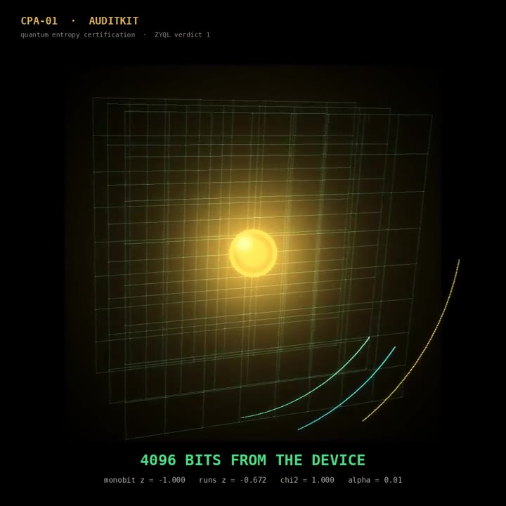</a>
  <a href="assets/demos/qrs01_regression_seal_30s.mp4">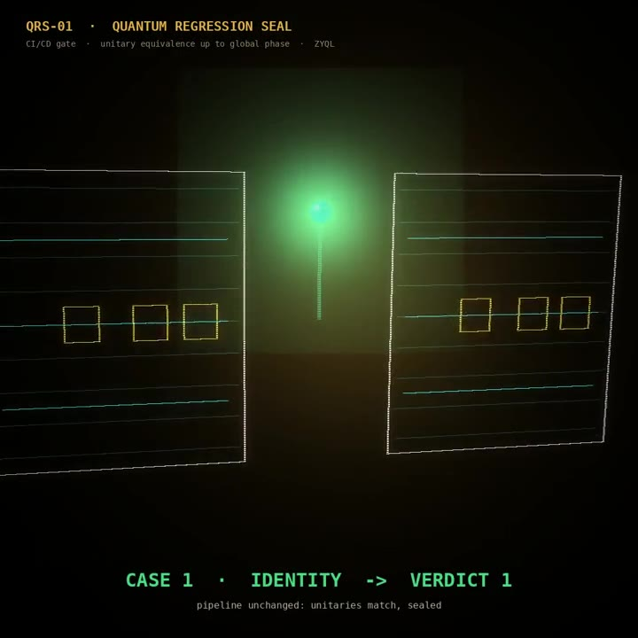</a>
  <a href="assets/demos/zyql_qroute_console_30s.mp4">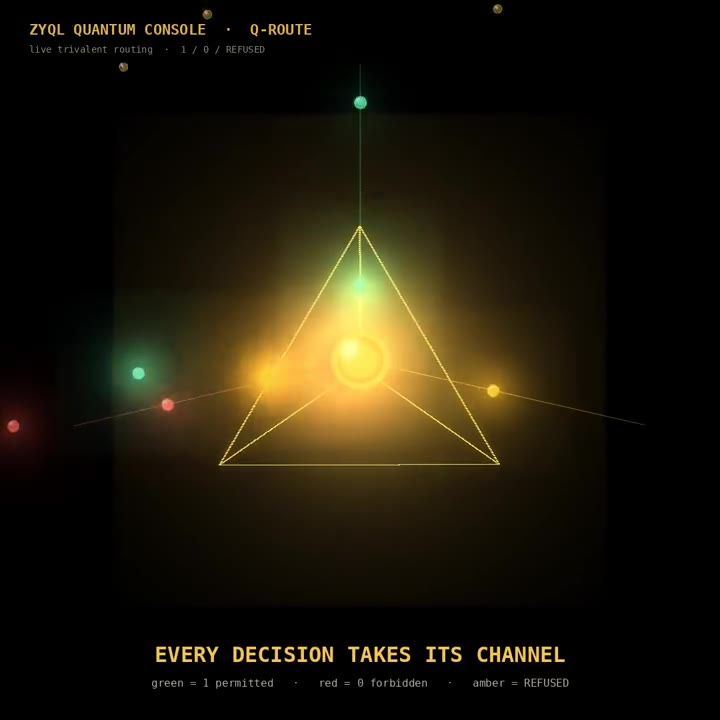</a>
  <a href="assets/demos/qsr01_readiness_38s.mp4">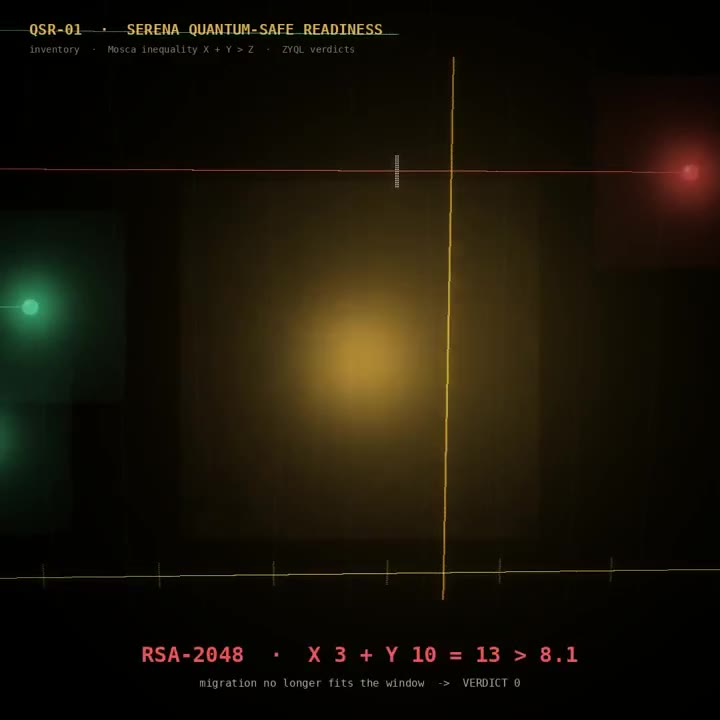</a>
  <a href="assets/demos/zyql_selfverified_38s.mp4">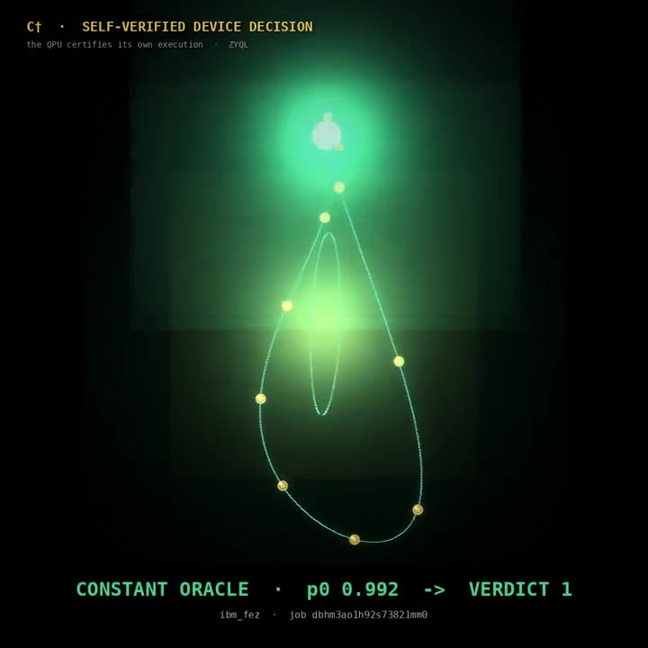</a>
</p>
<p align="center">
  <a href="assets/demos/zkem_envelope_38s.mp4">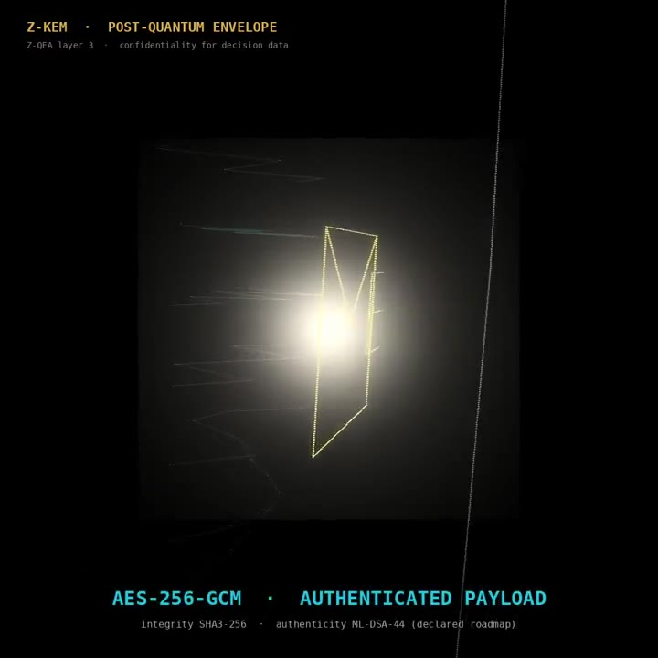</a>
  <a href="assets/demos/s3_anyon_braids_38s.mp4">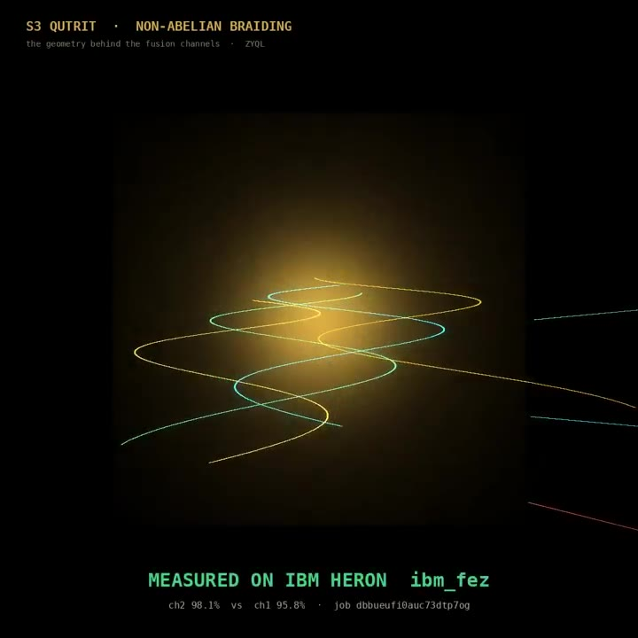</a>
  <a href="assets/demos/zyql_decision_core_30s.mp4">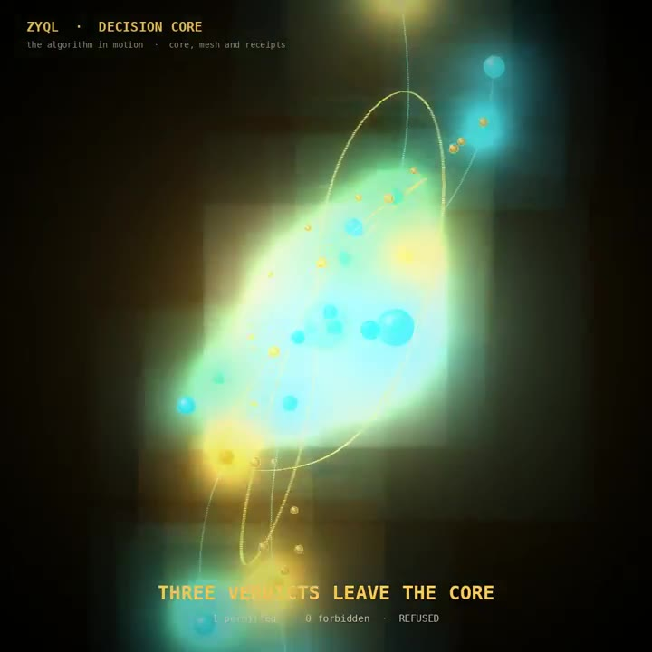</a>
  <a href="assets/demos/zyql_birth_lab_38s.mp4"></a>
</p>

<p align="center"><sub>
<b>CPA-01 AuditKit</b> — entropy certification, 4096 bits on a second lab device (job in internal evidence), verdict <code>1</code> ·
<b>QRS-01 Regression Seal</b> — CI/CD gate, identity <code>1</code> / phase bug <code>0</code> / gate bug <code>0</code> ·
<b>Q-ROUTE</b> — live trivalent routing ·
<b>QSR-01</b> — Mosca inequality: RSA-2048 <code>0</code>, X25519 <code>1</code>, ML-KEM-768 <code>1</code> ·
<b>Self-verified (C&#8224;)</b> — the QPU certifies its own run, selfcheck_p0 0.969 ·
<b>Z-KEM</b> — ML-KEM-768 + AES-256-GCM envelope ·
<b>S3 anyons</b> — braiding measured on a production QPU, 98.1% vs 95.8%
<br>All animations are declared simulations built over real receipts and job IDs.
</sub></p>

## Honest scope

This repository contains the language heart only: kernel, types, gate, receipts.
It does not contain, and will never contain, the Zephirum OS distribution,
bootloader, installer, or activation keys. Simulations are labeled as
simulations; without error correction, useful executions are bounded well
under 20 qubits.


> **Qual banda se aplica (esclarecimento de 08/11/2026).** A banda fixa **±0,15** vale no
> modo legado, quando nenhuma `epsilon` é declarada. Quando `epsilon` é informado, a banda é
> **calculada**: `m = sqrt(ln(2/ε)/(2·shots))`, e o valor depende de ε e do número de tiros
> (com ε = 0,05 e 2048 tiros, m ≈ 0,030; com 16 384 tiros, m ≈ 0,011). Números como ±0,042
> em material de divulgação referem-se a uma combinação específica de ε e tiros e não são
> uma segunda regra. Enquanto a revisão matemática da margem familiar não concluir, o valor
> **não deve ser apresentado como garantia estatística**, apenas como banda de decisão.

## Runtime de produção (mesma versão do pacote: ver `VERSION`)

```python
from zyql_runtime import decide, Verdict
r = decide(lambda x: x & 1, n=3, shots=512)   # -> Verdict.REFUSED
r.error_bound                                 # limite de erro Hoeffding declarado
```
CLI: `zyql-decide --oracle balanced --shots 512`

## PyPI — estado verificado (30/10/2026)

O pacote oficial **existe e está publicado**: `pip install zephirum`.
Versão publicada no PyPI: **2.5.7**, licença **Apache-2.0**, verificada em 08/11/2026. `VERSION` é a fonte única: badge, `pyproject.toml`, `docs/openapi.json` e `APP_VERSION` da API são conferidos por `tools/check_compliance.py` a cada commit.
Procedência verificável em https://pypi.org/pypi/zephirum/json — autor do
registro no PyPI: Reginaldo Gonçalves (mantenedor), projeto Serena Solutions.

O que **não** é da casa: pacotes de terceiros com nome parecido, como
`zephirum-quantum-plugin`, e o repositório `SerenaSolutions/zephirum`. O único
repositório oficial é `SerenaSolutions/zephirum-lang`, este. Instrução que cite
aqueles nomes não vem da ZEPHIRUM.

Correção registrada: até 30/10/2026 esta seção afirmava que nenhum pacote estava
no PyPI. Era falso, e a checagem passou a ser feita contra a API do índice, não
contra a memória de quem escreveu.

## Known limitations

Stated here so nobody has to discover them by failing:

- **Receipt integrity is not authorship.** Receipts carry SHA3-256, which proves
  content has not changed. They are not yet signed with ML-DSA-44, so anyone can
  regenerate the same hash. Author signature is
  [#68](https://github.com/SerenaSolutions/zephirum-lang/issues/68).
- **No independent reproduction yet.** The decision layer was validated against a
  pre-registered protocol (7 hypotheses, 3,630 cases, 0 violations), but by the
  same team that built it.
- **Hardware evidence is thin.** One execution per circuit on `ibm_marrakesh`,
  2,048 shots. It shows the device behaved as expected that day; it shows no
  throughput, no repeatability and no statistics.
- **The demonstration uses a simulator** with declared noise (2% depolarizing on
  each CX), not a QPU.
- **The finite domain is finite.** Absence of a counterexample in a discrete grid
  is not a universal proof.
- **Ecosystem status is `experimental` / `Very Early Project`**, as declared by the
  entry itself in [`Qiskit/ecosystem`](https://github.com/Qiskit/ecosystem). Being a
  member is metadata, not endorsement of results, and no code of this project runs
  inside Qiskit.

## How to participate

- **Found a wrong instruction?** Open an issue with the command, the Python
  version and the output you got. A documented failure is worth more than a
  compliment.
- **Want to refute a result?** The protocol, the domain and the command are
  published in [`validacao/`](validacao). Refutation needs one counterexample, not
  an opinion.
- **Scope we accept:** reproducible bug reports, documentation fixes, onboarding
  friction, additional oracles and language examples, adversarial tests of the
  decision layer.
- **Scope we are careful about:** new runtime dependencies. The project keeps a
  deliberately small dependency set (`lark`, `numpy`, `qiskit`).
- **Good first issues** are labelled in the issue tracker.

## Citation

See `CITATION.cff`. Software deposit: Zenodo concept DOI 10.5281/zenodo.23632019
(code Apache-2.0, companion thesis CC BY-NC-ND 4.0), (c) Serena Solutions.

## License

Apache-2.0 — see [LICENSE](LICENSE). A licença inclui concessão explícita de patentes,
necessária em computação quântica; a tese companheira permanece CC BY-NC-ND 4.0.

---

ZEPHIRUM&trade; e ZYQL&trade; sao marcas de Serena Solutions. O simbolo (betta quantico) e a identidade visual sao de uso reservado. O codigo e licenciado sob Apache-2.0, que **nao concede direito de uso das marcas** (Apache-2.0, secao 6). Veja `NOTICE`.
