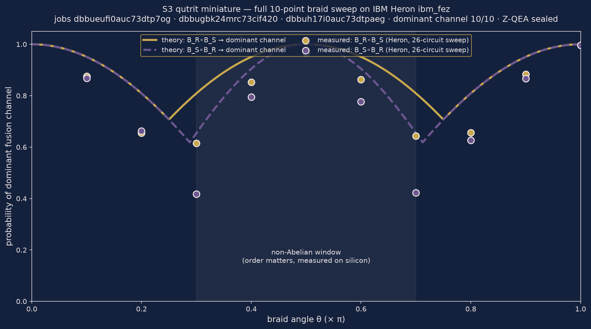

<p align="center"></p>

# ZEPHIRUM

**The quantum programming language with receipts.** ZYQL, its decision core, returns one of three verdicts — `1` (permitted), `0` (forbidden) or `REFUSED` (insufficient confidence) — and seals every decision in a verifiable receipt.


[](https://github.com/SerenaSolutions/zephirum-lang/actions/workflows/ci.yml)
[](https://pypi.org/project/zephirum/)
[](https://github.com/SerenaSolutions/zephirum-lang/actions/workflows/codeql.yml)


**Contents** — [What it is](#what-it-is) · [Quickstart](#quickstart) · [Evidence](#evidence) · [Architecture](#architecture) · [Tests & reproducibility](#tests--reproducibility) · [Learn](#learn) · [Layout](#layout) · [Scope & honest limits](#honest-scope) · [Citation](#citation)

---

## What it is

ZEPHIRUM is a small quantum programming language. ZYQL is its decision algorithm:
every computational decision is trivalent — `1` (permitted), `0` (forbidden),
`REFUSED` (input-dependent or insufficient confidence) — and carries a sealed
receipt (SHA3-256 integrity seal, hash proves content integrity, not authorship).
ML-DSA-44 / FIPS 204 signatures are a DECLARED ROADMAP item — to be implemented
with an accredited module and HSM-held keys, never hand-rolled (see [docs/receipts.md](docs/receipts.md)).

Decisions are produced by Deutsch–Jozsa interference, one oracle call, with a
declared noise band (±0.15). Nothing executes silently: unknown syntax raises
an explicit error. Simulation mode is labeled as simulation.

- **Trivalent semantics** — refusal is a first-class verdict, not an exception.
- **Receipts by construction** — every decision can be sealed (Z-QEA, SHA3-256).
- **Hardware-verified** — measured on IBM Heron with job IDs published below.


**Search:** [`"ZYQL" quantum language`](https://www.google.com/search?q=%22ZYQL%22+quantum+language) · [`Zephirum receipts`](https://www.google.com/search?q=%22Zephirum%22+quantum+recibos+OR+receipts) · [`trivalent REFUSED`](https://www.google.com/search?q=%22trivalent%22+%22REFUSED%22+quantum+decision) · [`zephirum on PyPI`](https://www.google.com/search?q=%22zephirum%22+PyPI)

## Quickstart

```bash
git clone https://github.com/SerenaSolutions/zephirum-lang.git && cd zephirum-lang
pip install -e .            # or: PYTHONPATH=src
```

```python
from zyql_quantum_gate import ZYQLQuantumGate

gate = ZYQLQuantumGate(3, lambda x: x ^ 1)      # balanced oracle
r = gate.run_quantum(shots=2048)
print(r["decision"], r.get("refusal_reason", ""))   # REFUSED BALANCED_ORACLE
```

```bash
zyql-decide --oracle balanced --shots 512      # CLI runtime, Hoeffding error bound
python3 src/zyql_lisp.py examples/hello_world.zph   # language front-end + sealed receipt
```

The baptism of the language — a trivalent greeting, sealed by ZEPHIRUM itself:

```lisp
;; hello_world.zph — ZEPHIRUM v2 (Lisp)
(hello "Zephirum")
(seal "examples/hello_world.receipt.json")
```

```console
$ python3 src/zyql_lisp.py examples/hello_world.zph
Hello, Zephirum! | decisao = 1
SELO: <sha3-256 do recibo — carimbo temporal, varia por execucao>
```

The `hello` form prints the greeting and returns the trivalent verdict `1`
(a greeting is always permitted). The `seal` form writes a Z-QEA receipt
(SHA3-256) of everything executed — the Hello World carries a sealed receipt,
as every decision in this house does. Source: [`examples/hello_world.zph`](examples/hello_world.zph).

## Evidence



*Real-data figure: theoretical braid curves (gold: B_R∘B_S, violet: B_S∘B_R) and the
points measured on IBM Heron `ibm_fez` — 98.1% vs 95.8%. The braid order is
distinguishable on silicon. Full detail: [docs/PROOFS.md](docs/PROOFS.md).*


*Hero art (declared: AI-generated) — braided world-lines of non-Abelian anyons
converging into three fusion channels, the geometry the experiments probe.*

### Proofs of concept — non-Abelian anyons (S3 qutrit miniature)

| Claim | Mode | Result | Receipt |
|-------|------|--------|---------|
| Fusion space is 3-dimensional (qutrit in 2 qubits) | noiseless | exact 1/3+1/3+1/3, forbidden channel vetoed | [sealed receipt](experiments/s3_qutrit_final_receipt.json) |
| Braiding is non-Abelian (order matters) | noiseless | commutator L1 = 6 exact; B_R∘B_S → ch2, B_S∘B_R → ch1 | same |
| Noiseless round | noiseless | exact-zero deviation vs theory (canonical rationals) | same |
| ZYQL trivalent decisions 1 / 0 / REFUSED | **IBM Heron** | **3/3 PASS** (job `dbbugbk24mrc73cif420`) | [battery receipt](experiments/zyql_hardware_battery.json) |
| Braid order measured on real hardware | **IBM Heron** | **98.1% vs 95.8%** (job `dbbueufi0auc73dtp7og`) | [master receipt](experiments/s3_qutrit_final_receipt.json) |
| **Shots-to-verdict efficiency** | **IBM Heron** | **256 shots** to a first-step verdict — **96.88% savings vs 8192** | receipt `28f406202e9d125a` (issue #40) |

Receipt seal (SHA3-256): `a44192463ea669564a3da51728c8577e59e5684c67cf2d48f7a95442d548476a` — verify it yourself: `python3 .github/actions/zqea-verify/zqea_verify.py experiments/s3_qutrit_final_receipt.json`
In language: [`examples/s3_qutrit.zph`](examples/s3_qutrit.zph).

Verified on real hardware (IBM Heron `ibm_fez`, cited as test laboratory with
verifiable job IDs; no endorsement claimed):

- Constant purpose: measured p(000)=0.9844 (job `db6ded84qg6s73c4jvug`)
- S3 qutrit miniature: fusion channels (qutrit-in-qubits) + braiding non-commutativity,
  noiseless with exact-zero deviation and on hardware: ch2=98.1% (RS) vs ch1=95.8% (SR),
  full ZYQL battery 3/3 PASS on `ibm_fez` (jobs `dbbueufi0auc73dtp7og`, `dbbugbk24mrc73cif420`;
  Z-QEA receipt sealed, see `experiments/`)
- Balanced purpose: p(000)=0.0000, orthogonal outcome 93.9%
- Same-task confrontation vs textbook Qiskit (job `db6dklcvf2bc73d122t0`):
  Zephyron transpiles to depth 2 / 0 two-qubit gates vs depth 10 / 3 CZ

Benchmark suite: [`benchmarks/`](benchmarks/) (public comparative benchmark, issue #28).

## Architecture

```
 program (.zph, Lisp)  ──►  front-end parser ──► canonical decision form
        │                                              │
        │                                    Deutsch–Jozsa interference
        │                                    (one oracle call, noise band ±0.15)
        │                                              │
        │                                    trivalent verdict: 1 / 0 / REFUSED
        │                                              │
        └──────────────►  Z-QEA receipt  ◄─────────────┘
                     (SHA3-256 seal + machine-readable refusal_reason)
```

The repository ships the language heart only: kernel (state-vector, `[re,im]`
float64), OpenQASM 3 transpiler, trivalent gate, quantum types (no-cloning
enforced) and the receipt chain. See [Honest scope](#honest-scope).

The language:

```
circuit bell {
  qubit[2] q;
  H q[0];
  CNOT q[0] -> q[1];
}
```

## Tests & reproducibility

- **13 test suites** (`tests/`): canonical rational battery, certified decisions,
  frontiers, KEM, Lisp regression, meta, multiple-testing correction,
  runtime, shot auditor, Z-QEA verifier, hardware rounds.
- **CI matrix**: Python 3.10 and 3.11 on every push and pull request, with
  `PYTHONHASHSEED=0` for reproducible runs; **CodeQL** static analysis;
  **signed releases with build provenance** (SLSA attestation); a dedicated
  **ZQ-GATE self-test** workflow.
- **Statistical discipline**: multiple-comparison correction is part of the test
  battery — verdicts are not claimed on uncorrected p-values.
- **Verifiable by construction**: every hardware claim above points to a sealed
  receipt and a job ID; receipts are re-verifiable with
  `.github/actions/zqea-verify/zqea_verify.py`.
- Published testing roadmap (fuzzing the front-end, unitary-equivalence
  assertions, executed notebooks, coverage gate): tracked in issues.

## Learn

- [docs/LEARN.md](docs/LEARN.md) — progressive tutorial: first decision to sealed hardware receipts
- [docs/COOKBOOK.md](docs/COOKBOOK.md) — copy-paste recipes, every one executed and recorded
- [docs/MIGRATION.md](docs/MIGRATION.md) — embedding Zephirum in Python, C and CI pipelines
- [docs/PROOFS.md](docs/PROOFS.md) — hardware proofs, figures and receipts
- [docs/MATURITY.md](docs/MATURITY.md) — component-by-component maturity

## Layout

- `src/` — kernel (state-vector), OpenQASM 3 transpiler, trivalent gate,
  quantum types (no-cloning enforced), neural RAG layer, runtime (`zyql_runtime`)
- `tests/` — 13 suites (see above)
- `examples/` — `hello_world.zph`, `bell.zph`, `grover.zph`, `dj_constant.zph`, `s3_qutrit.zph`
- `benchmarks/` — public comparative benchmark suite
- `notebooks/` — scientific presentation layer
- `experiments/` — hardware rounds and sealed receipts (job IDs)
- `docs/` — language reference, receipt specification, proofs, maturity, dossier
- `playground/` — browser playground assets · `site/` — docs site · `paper/` — preprint sources
- `zephirum-vscode/` — VS Code extension for `.zph`
- `docker/` — reproducible container

## Technical Dossier

A consolidated, receipt-cited dossier of the project — what it is, what has been measured on real quantum hardware, the public m50 commitment, Industry 5.0 applications and the declared honest limits: **[docs/DOSSIER.md](docs/DOSSIER.md)**


## Self-verified device decision (new, 2026-10-29)

A decisão trivalente agora roda **na QPU** com a própria QPU certificando a execução:

- **Auto-verificação (espelho C†)** no mesmo job — taxa de zeros medida vira `selfcheck_p0` no recibo; abaixo do limiar ⇒ `REFUSED`.
- **Evidência sequencial** com regra de parada (alpha-spending) declarada **antes** da execução.
- **Recibo** com protocolo + contagens por lote + `job_id`, selado SHA3-256.

| Oráculo | Veredito | p0 | selfcheck | Shots | job_id (ibm_fez) |
|---|---|---|---|---|---|
| constante | **1** | 0.992 | 0.969 | 128 | `dbhm3ao1h92s73821mm0` |
| balanceado | **0** | 0.016 | 0.992 | 128 | `dbhm3ik2d77s739d10j0` |

Especificação completa: **[docs/SELFVERIFIED.md](docs/SELFVERIFIED.md)** · recibos em `experiments/selfcheck_ibm_fez_20261029/`.


## Refusal witness — abstenção com prova (new, 2026-10-29)

`REFUSED` deixa de ser "não sei" e vira "não sei **porque** a evidência não fecha":
a TVD entre a distribuição ideal (referência exata) e a medida no dispositivo tem
intervalo de confiança declarado **antes** da execução.

| Dispositivo | Shots | TVD | Janela | ε | Veredito | job_id |
|---|---|---|---|---|---|---|
| ibm_fez | 4096 | 0.0317 | [0.000, 0.104] | 0.10 | **REFUSED** | `dbhn296ne4hc73bd7u1g` |
| ibm_marrakesh | 8192 | 0.0198 | [0.000, 0.071] | 0.10 | **1 CERTIFICADO** | `dbhn8hs2d77s739d32lg` |

O primeiro voo absteve; com o dobro de evidência, certificou. Especificação:
**[docs/WITNESS.md](docs/WITNESS.md)** · recibos em `experiments/witness_20261029/`.


## Hardware protocols (2026-10-29)

Protocolos pré-declarados, executados no plano Open com recibo selado
(`docs/PROTOCOLS.md`):

| Protocolo | Medida | Resultado | job_id |
|---|---|---|---|
| P-10 fronteira clássica×hardware | TVD vs ideal, n=3..5 | 0.0139 / 0.0188 / 0.0183 | `dbhp6ks2d77s739d692g` |
| P-08 ZNE vs C† | p0 n=4, com/sem ZNE | 0.0197 → **0.0116** (−41%) | `dbhp6ok2d77s739d6990` |


## Apps v1 (2026-10-29)

- **AuditKit (CPA-01)** — certificacao de entropia quantica com recibo: hardware
  `ibm_marrakesh`, 4096 bits, veredito **1** (job `dbhpaomne4hc73bdbp7g`).
- **Quantum Regression Seal (QRS-01)** — gate de CI/CD que pega miscompilacao
  silenciosa por comparacao unitaria; action reutilizavel no repo.

Detalhes: **[docs/APPS.md](docs/APPS.md)**

## Honest scope

This repository contains the language heart only: kernel, types, gate, receipts.
It does not contain, and will never contain, the Zephirum OS distribution,
bootloader, installer, or activation keys. Simulations are labeled as
simulations; without error correction, useful executions are bounded well
under 20 qubits.

## Runtime de produção (v1.8.0)

```python
from zyql_runtime import decide, Verdict
r = decide(lambda x: x & 1, n=3, shots=512)   # -> Verdict.REFUSED
r.error_bound                                 # limite de erro Hoeffding declarado
```
CLI: `zyql-decide --oracle balanced --shots 512`

## ⚠️ Desambiguação / Disambiguation — no PyPI package exists

Instruções circulando na web citam `pip install zephirum-quantum-plugin` e um
repositório `SerenaSolutions/zephirum`. **Nenhum dos dois existe.** Este
(`zephirum-lang`) é o único repositório oficial. Nenhum pacote da ZEPHIRUM está
publicado no PyPI — qualquer instrução citando esse pacote não vem da casa.

## Citation

See `CITATION.cff`. Software deposit: Zenodo concept DOI 10.5281/zenodo.23632019
(code MIT, companion thesis CC BY-NC-ND 4.0), (c) Serena Solutions.

## License

MIT — see [LICENSE](LICENSE).
