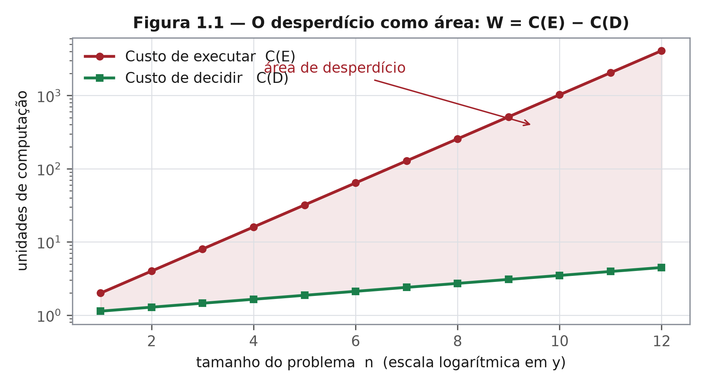

# Capítulo 1 — O mundo executa antes de perguntar
*ZEPHIRUM — A Computação Antes da Execução | Parte I: A Pergunta*

## 1.1 Nível 1 — A casa demolida

Para saber se a porta da frente está aberta, há dois caminhos: caminhar dez passos e olhar, ou contratar uma equipe para demolir a casa, examinar cada tijolo, reconstruí-la e então declarar que a porta estava aberta.

Ninguém escolheria o segundo caminho para uma porta. A engenharia da computação escolhe esse caminho todos os dias.

Lançamos modelos sobre temporais inteiros para saber se choverá ao meio-dia numa praça específica. Somamos listas completas quando os três primeiros elementos já determinam a resposta. Reservamos processadores quânticos para perguntas que uma identidade algébrica resolve em uma linha [1, 2]. Executamos primeiro; perguntamos depois, se sobra tempo.

Este livro nasce de uma pergunta que deveria preceder todas as outras:

> Eu realmente preciso executar esta computação para responder à pergunta que fiz?

A tese defendida aqui não é que a execução seja dispensável. É que **a necessidade de executar é uma propriedade demonstrável do problema, não uma suposição do programador**. Quando é demonstrável, deve ser demonstrada antes; quando não é, o sistema deve dizer que não é.

## 1.2 Nível 2 — O contrato antes do programa

A prática corrente inverte a ordem do trabalho: escolhe-se um algoritmo, escreve-se um programa, executa-se, e só então se descobre o que a execução informou sobre a pergunta original. O custo dessa inversão é medido no capítulo 2.

A inversão proposta é pequena na forma e larga na consequência: um problema não chega sozinho. Ele chega acompanhado de

- **pergunta** — a proposição verificável que se deseja decidir;
- **tolerância** — o erro admissível na decisão;
- **orçamento** — o custo máximo aceitável;
- **hipóteses** — o que pode ser assumido sobre os dados;
- **restrições** — o que deve ser preservado.

Ao conjunto damos o nome de **contrato**. O contrato é o objeto formal do livro, definido no capítulo 8. Com ele, três perguntas organizam todo o restante:

1. É necessário executar para responder à pergunta formulada?
2. Se for, qual é a menor computação justificável?
3. Como provar que o que foi eliminado era, de fato, dispensável?

A Figura 1.1 fixa a intuição que sustenta o argumento: quando o custo de decidir cresce muito mais devagar que o custo de executar, a área entre as duas curvas é desperdício puro, e cresce exponencialmente com o tamanho do problema.

## 1.3 Nível 3 — Do programa à prova

Formalmente, dado um problema $P$, uma pergunta $Q$ e um contrato $C = (\varepsilon, B, M)$ — tolerância, orçamento e modelo de computação —, o sistema procura um **núcleo de decisão** (decision kernel): um procedimento certificado suficiente para decidir $Q$ sob $C$ com a menor computação justificável disponível.

O resultado é um veredito explícito, pertencente a um conjunto de três valores, detalhado no capítulo 10:

| Veredito | Significado | Condição |
|---|---|---|
| 1 | decidido afirmativamente | dentro da banda declarada, com evidência suficiente |
| 0 | decidido negativamente | fora da banda, com evidência suficiente |
| REFUSED | abstenção | evidência insuficiente para qualquer decisão honesta |

A mudança de paradigma é de natureza, não de grau: sai-se de `ALGORITMO → EXECUTAR` e entra-se em `PROVA → EXECUTAR`. O capítulo 5 mostra que nenhuma peça isolada dessa inversão é nova; o capítulo 7 delimita o que a composição acrescenta.

## 1.4 Contribuições declaradas

Este livro faz quatro afirmações, e apenas quatro:

1. existe uma classe mensurável de computações cuja necessidade pode ser decidida a custo muito inferior ao da execução (capítulos 2 e 8);
2. essa decisão pode ser formalizada como contrato, com tolerância e orçamento explícitos (capítulos 8 e 9);
3. cada decisão pode ser selada em recibo verificável por terceiros, com integridade, autoria e encadeamento (capítulo 12);
4. o sistema é capaz de recusar — e a recusa é resultado legítimo, não falha (capítulos 10 e 14).

Nenhuma dessas afirmações depende de superioridade de hardware. Todas são falseáveis, e o capítulo 6 descreve o experimento que tentou falseá-las.

## 1.5 Como ler este livro

Cada capítulo abre no nível 1, para qualquer leitor; desenvolve no nível 2, para o cientista e o engenheiro; e fecha no nível 3, para a ciência da computação. As transições são marcadas. Os níveis não são três livros: são três profundidades do mesmo argumento, e o leitor pode percorrer apenas o nível que lhe interessa sem perder a linha.

Referências aparecem entre colchetes e são listadas ao final. Resultados numéricos citados no texto estão amarrados a recibos do repositório do projeto e do registro científico [R1] e [R3], cuja verificação é descrita no capítulo 12 e no Apêndice C.

## Exercícios

1. Descreva uma computação, na sua área, que poderia ser dispensada se houvesse um predicado de decisão barato. Qual seria esse predicado?
2. Por que a abstenção precisa ser um valor do sistema, e não um erro em tempo de execução?
3. O capítulo afirma que a necessidade de executar é "demonstrável". Em que condições essa afirmação deixa de valer? (Antecipação: capítulo 3 e capítulo 15.)
