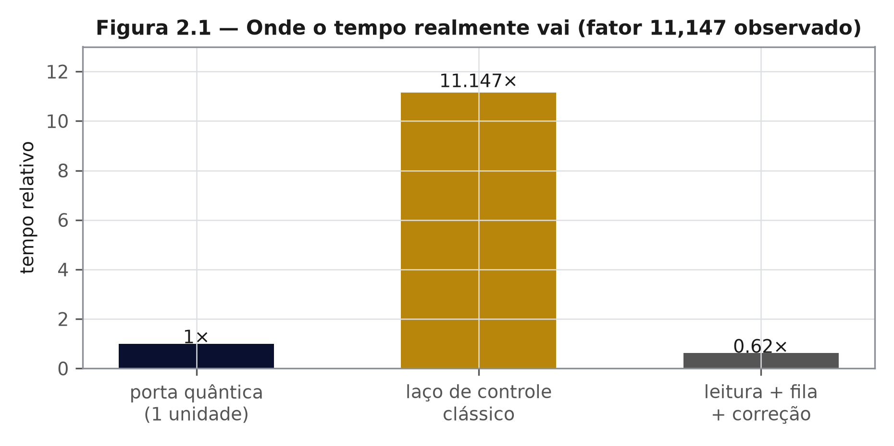

# Capítulo 2 — Observação: computações que ninguém precisava fazer
*ZEPHIRUM — A Computação Antes da Execução | Parte I: A Pergunta*

## 2.1 Nível 1 — O relatório que demora três horas para dizer não

Todo engenheiro reconhece a cena. O relatório que roda a noite inteira para concluir que a resposta era negativa. A simulação que consome a fila do cluster para confirmar o que o primeiro dado já havia decidido. O carro de luxo usado para buscar pão na esquina.

A computação moderna é generosa consigo mesma: executa porque pode, não porque deve. A conta dessa generosidade aparece em energia, em fila de supercomputador e em horas de máquina que não precisavam existir.

## 2.2 Nível 2 — Três classes de desperdício, medidas

**Primeira classe: a resposta já estava decidida.** Somas cujo sinal é determinado pelos primeiros termos; consultas de resultado constante; circuitos cujo estado final é separável por construção e, portanto, previsível classicamente sem uma única porta [1].

**Segunda classe: o custo está no laço, não na unidade.** Em sistemas híbridos quântico-clássicos, o gargalo raramente é o processador quântico. Em medição própria do laboratório do projeto, a sobrecarga do laço de controle sobre o tempo de porta alcançou **11,147 vezes** [R1]. A Figura 2.1 compara as três parcelas.

**Terceira classe: a pergunta é menor que a máquina.** Reservar cinco qubits para um problema que uma identidade algébrica resolve em uma linha é a demolição da casa do capítulo 1, com fatura de QPU.

A leitura da figura é a lição de engenharia do capítulo: acelerar a unidade que já consome 1 unidade de tempo, quando o laço consome 11, produz ganho imperceptível; atacar o laço produz ganho de ordem de grandeza. É a diferença entre comprar velocidade e construir um sistema rápido.

## 2.3 Nível 3 — Formalização do desperdício

Seja $C(E)$ o custo de executar a computação e $C(D)$ o custo de decidir se ela é necessária. Define-se desperdício como

$$ W \;=\; C(E) - C(D) $$

Quando $C(D) \to 0$ — porque a decisão é um predicado barato sobre a estrutura do problema —, o desperdício tende ao custo integral da execução. A observação que fundamenta o livro é que existe uma classe relevante de computações com predicado de decisão barato disponível, e que esse predicado não é consultado antes do disparo.

Duas ressalvas metodológicas, declaradas desde já. Primeira: $C(D)$ raramente é nulo; o ganho real é $C(E) - C(D)$, e um juiz caro pode custar mais do que economiza. Segunda: a existência de um predicado barato para uma classe não implica existência para todas — o capítulo 15 delimita a jurisdição.

## 2.4 Como a observação foi medida

O fator 11,147 não é estimativa: é razão entre tempo de parede do laço de controle e tempo de parede de porta, medida em execução instrumentada, com registro no recibo correspondente do ledger [R1]. A metodologia completa está no Apêndice C, junto ao recibo.

Toda medição neste livro obedece a três regras, adotadas a partir do capítulo 14:

1. a banda de decisão é declarada **antes** da execução;
2. todo número publicado vem acompanhado de intervalo e de identificador de recibo;
3. resultado negativo é publicado com o mesmo peso do positivo.

A terceira regra é a mais custosa e a mais importante. Um livro que publica apenas vitórias não é científico: é catálogo.

## 2.5 Objeções previstas

**"Isso é apenas otimização de compilador."** Em parte, sim — e o capítulo 5 reconhece a dívida. A diferença é que otimização de compilador decide sobre transformações de código; aqui se decide sobre a necessidade da computação, com contrato explícito e recibo auditável.

**"O ganho desaparece em problemas grandes."** Pode desaparecer, e o capítulo 15 mostra exatamente onde: quando o custo da análise cresce mais rápido que o custo da execução, o NetBenefit fica negativo e o sistema deve registrar isso, não esconder.

## Exercícios

1. Dê um exemplo, da sua área, de computação da primeira classe. Qual seria o predicado de decisão barato?
2. No caso do fator 11,147, que parte do sistema você otimizaria primeiro, e por quê?
3. Escreva $W = C(E) - C(D)$ para a soma de uma lista cujo sinal já é conhecido após três elementos. Qual é o $C(D)$ ótimo?
