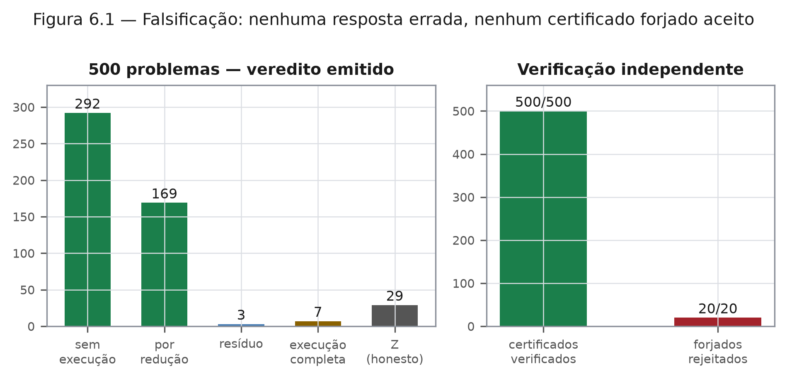

# Capítulo 6 — Falsificação: tentar fazer o sistema errar
*ZEPHIRUM — A Computação Antes da Execução | Parte II: O Tribunal da Ciência*
*Protocolo pré-registrado; N = 500; semente 42; reproduzível*

## 6.1 Nível 1 — Três ataques

Uma arquitetura que promete eliminar computação precisa ser atacada. Fizemos três coisas com o sistema.

Primeiro, lançamos sobre ele **500 problemas gerados ao acaso** — somas com limiar, médias com dados faltantes, incógnitas com e sem limites —, cada um com a verdade calculada à parte, por força bruta, sem consultar o sistema. Segundo, exigimos que **toda decisão viesse com certificado**, conferido por um verificador independente do motor. Terceiro, **atacamos o próprio sistema**: forjamos 20 certificados — alterando somas, testemunhos e limites — e verificamos se eram aceitos.

O resultado: o sistema não errou nenhuma resposta; os 500 certificados passaram na verificação independente; e os 20 certificados forjados foram todos rejeitados. Quando não sabia, disse REFUSED — 29 vezes — em vez de inventar.

## 6.2 Nível 2 — Protocolo e resultados

**Protocolo.** 500 problemas, semente fixa, quatro famílias: somas com monotonicidade declarada (40%); incógnitas com limites e oráculo executável (30%); incógnitas sem oráculo, em que a recusa é o único acerto possível (20%); médias com cinco desconhecidos, com e sem limites (10%). Para cada problema, o motor decide; a verdade é calculada à parte; todo certificado é reverificado a partir da fonte original.

| Métrica | Valor | Intervalo 95% |
|---|---|---|
| Problemas | 500 | — |
| Decididos | 471 (94,2%) | [91,8%; 96,0%] |
| Recusas declaradas (REFUSED) | 29 (5,8%) | [4,0%; 8,2%] |
| Respostas erradas | **0** | [0; 0,76%] |
| Certificados verificados | **500/500** | — |
| Certificados forjados rejeitados | **20/20** | — |
| Unidades de computação demandadas | 3.784 | — |
| Unidades efetivamente executadas | 789 | — |
| Unidades eliminadas com certificado | 2.995 (79,2%) | [77,9%; 80,4%] |
| NetBenefit agregado | +2.946,23 | — |

Intervalos calculados por Clopper-Pearson [26]; a escolha é conservadora, e a razão aparece no capítulo 14, quando a regra de decisão foi trocada.

**Distribuição dos estados.** 292 decisões sem execução alguma; 169 por redução; 3 exigiram resíduo; 7 exigiram execução completa; 29 permaneceram em abstenção. A Figura 6.1 apresenta a distribuição e o resultado dos ataques.

## 6.3 Nível 2 — Os números que doem

Três casos consumiram mais computação do que o previsto: o custo da análise superou a economia, e o NetBenefit individual foi negativo. O agregado permaneceu positivo (+2.946,23), mas esconder os três casos seria fraude estatística. Eles estão registrados no ledger [R1] e discutidos no capítulo 15.

Registre-se também o que **não** foi demonstrado: a taxa de falsa eliminação, medida nos casos com eliminação barata, foi zero detectado — mas amostra pequena não prova ausência de erro. O capítulo 15 trata essa lacuna como lacuna.

## 6.4 Nível 3 — Ameaças à validade

| Ameaça | Descrição | Mitigação adotada |
|---|---|---|
| validade interna | verdade calculada pelo mesmo autor do sistema | cálculo independente por força bruta e verificador separado |
| validade externa | problemas sintéticos, não de produção | declaração explícita: capítulo 15 |
| validade de construto | "certificado" pode medir outra coisa | especificação do recibo, capítulo 12 |
| validade estatística | múltiplas comparações | correção de Benjamini-Hochberg [29] quando aplicável |
| reprodutibilidade | execução não repetível | semente fixa, script versionado, recibo por decisão |

A tabela é a parte do capítulo que mais deve ao método experimental: sem ela, os números seriam anedota bem formatada.

## Exercícios

1. Por que 500 certificados verificados não equivalem a 500 decisões corretas? O que cada métrica mede?
2. O intervalo de confiança para "respostas erradas" é [0; 0,76%]. Interprete-o para um leitor não estatístico.
3. Proponha um teste que atacaria a validade externa do experimento.
