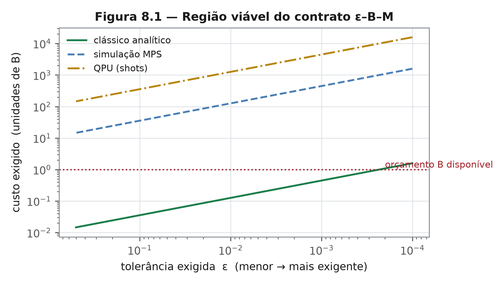

# Capítulo 8 — Formalização: pergunta, contrato, tolerância e orçamento
*ZEPHIRUM — A Computação Antes da Execução | Parte III: A Arquitetura*

## 8.1 Nível 1 — Cinco cláusulas

Todo contrato sério tem cláusulas. O desta linguagem tem cinco, e cada uma cabe em uma linha.

## 8.2 Nível 2 — O contrato

Um programa declara:

- **ASK** — a pergunta, como proposição verificável;
- **CONTRACT** — a tolerância $\varepsilon$ e o orçamento $B$;
- **MODEL** — o modelo de computação admitido: algébrico, clássico, paralelo, simulação, QPU;
- **BUDGET** — como o custo é medido: tempo, energia, dinheiro, shots;
- **REQUIRE** — o que se exige de saída: veredito, certificado ou ambos.

O triângulo $\varepsilon$–$B$–$M$ é o coração do capítulo. Dado o que se aceita errar, o que se pode gastar e onde se pode rodar, o juiz escolhe o degrau mais barato da escada do capítulo 11 que entrega a resposta dentro do contrato. Se nenhum degrau serve, o veredito é REFUSED, e o contrato proíbe chutar.

## 8.3 Nível 2 — Exemplo numérico

Pergunta: a soma de uma lista de $10^6$ inteiros excede $10^9$?

| Degrau | Custo relativo | Erro máximo | Cabe em $\varepsilon = 10^{-6}$? |
|---|---|---|---|
| identidade (cota superior) | $10^{-6}$ | 0 | sim |
| simplificação (primeiros 10³ termos) | $10^{-4}$ | 0 | sim |
| clássico completo | $1$ | 0 | sim, mas 6 ordens acima |

O contrato com $\varepsilon = 10^{-6}$ e $B = 10^{-3}$ é satisfeito no primeiro degrau. A execução completa é tecnicamente correta e contratualmente injustificada — distinção que a engenharia corrente não faz.

## 8.4 Nível 3 — Decidibilidade por construção

Seja $D$ o conjunto finito de decisores disponíveis, cada um com custo $c(d)$, risco $\delta(d)$ e modelo $m(d) \in M$. O juiz resolve

$$ d^{*} = \arg\min_{d \in D}\, c(d)\quad\text{sujeito a}\quad \delta(d)\le\varepsilon,\; c(d)\le B,\; m(d)\in M $$

Três propriedades seguem da definição, e nenhuma exige teoria profunda:

1. **decidibilidade** — $D$ é finito e os predicados são computáveis; a busca termina;
2. **honestidade** — se o conjunto viável é vazio, o resultado é REFUSED, não o "menos pior";
3. **monotonicidade** — relaxar $\varepsilon$ ou $B$ nunca reduz o conjunto viável.

A relação com o problema da parada [3] é a esperada: sem contrato, $D$ é ilimitado e a busca não termina; com contrato, o juiz é um otimizador sob restrições. O preço da decidibilidade é a jurisdição restrita — e o capítulo 15 explicita esse preço.

## 8.5 O que o contrato não resolve

O contrato não garante que $\delta(d)$ seja conhecido com precisão. Na prática, $\delta$ é estimado, e estimativa de risco é ela própria sujeita a erro. Essa é a razão de o capítulo 14 dedicar uma seção à regra de decisão estatística: um contrato com $\delta$ mal estimado certifica o que não deveria. O caso real está documentado — 12% de certificação indevida na borda.

## Exercícios

1. Escreva o contrato $\varepsilon$–$B$–$M$ para "estimar a média de uma lista com 1% de erro, gastando no máximo um centavo".
2. O que acontece quando $\varepsilon \to 0$ e $B \to 0$ simultaneamente? Por que a recusa é a única resposta honesta nesse regime?
3. Prove que, com $D$ finito, o problema do juiz é decidível por construção.
