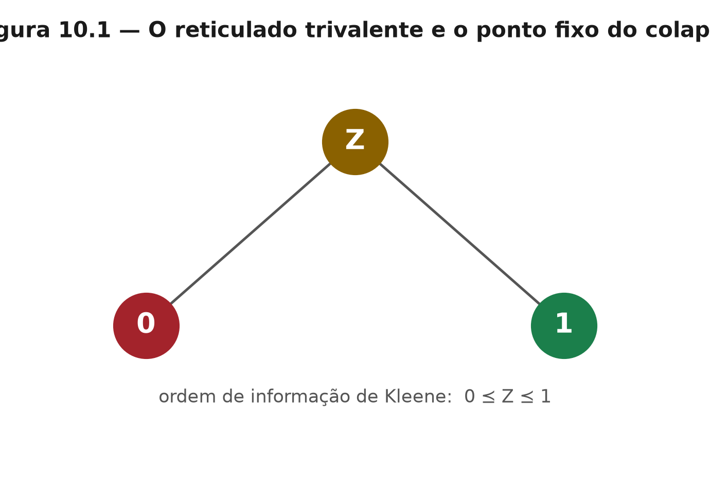

# Capítulo 10 — O terceiro valor: 0, 1 e REFUSED
*ZEPHIRUM — A Computação Antes da Execução | Parte III: A Arquitetura*

## 10.1 Nível 1 — A resposta mais valiosa

Toda linguagem tem dois valores: sim e não, zero e um. Esta tem três. O terceiro chama-se REFUSED, e é a resposta mais valiosa que um sistema honesto pode dar: "não sei, e não vou fingir que sei".

## 10.2 Nível 2 — Duas leituras do mesmo valor

**Leitura quântica.** Antes da medição, o estado $|+\rangle = (|0\rangle+|1\rangle)/\sqrt{2}$ não é 0 nem 1: é a superposição que ainda não colapsou [1].

**Leitura lógica.** REFUSED é o UNKNOWN de Kleene [4]: o valor que a propagação carrega sem contaminar os outros dois. As tabelas abaixo são as de Kleene, e valem para a camada lógica.

| $\wedge$ | 0 | REFUSED | 1 |
|---|---|---|---|
| **0** | 0 | 0 | 0 |
| **REFUSED** | 0 | REFUSED | REFUSED |
| **1** | 0 | REFUSED | 1 |

| $\vee$ | 0 | REFUSED | 1 |
|---|---|---|---|
| **0** | 0 | REFUSED | 1 |
| **REFUSED** | REFUSED | REFUSED | 1 |
| **1** | 1 | 1 | 1 |

A propriedade que interessa é a assimetria: $0 \wedge \text{REFUSED} = 0$. Mesmo sem saber o segundo operando, a conjunção com falso está decidida. É exatamente isso que a avaliação preguiçosa explora — e é a razão de a abstenção não contaminar decisões já resolvidas.

## 10.3 Nível 2 — A prova pública de honestidade

Em outubro de 2026, no processador `ibm_marrakesh` da IBM Quantum, o teste CHSH da desigualdade de Bell [15, 16] retornou

$$ S = 2{,}07 \pm 0{,}12 $$

O limite clássico é 2, e o limite de Tsirelson é $2\sqrt{2} \approx 2{,}83$. O valor medido está acima de 2 dentro do intervalo, mas o intervalo cruza o limite: não há violação estatisticamente demonstrável com 200 shots. A simulação sem ruído, executada ao lado, marcou 2,76.

O sistema poderia ter arredondado a narrativa para "violação detectada". Emitiu REFUSED, com recibo de hash SHA3-256 publicado [R1]. Dizer o número real quando ele desmonta o palco é o que o terceiro valor significa na prática.

## 10.4 Nível 3 — Ponto fixo e métricas de sistema

O terceiro valor é o ponto fixo do colapso contratual: o valor $v$ tal que $\text{decidir}(v)=v$. A leitura quântica obedece à regra de Born; a leitura lógica obedece a Kleene. O núcleo registra, em cada recibo, as três métricas de sistema que situam a decisão: **qubits programáveis**, **profundidade transpilada** e **throughput** em circuitos por segundo.

| Métrica | Por que entra no recibo |
|---|---|
| qubits programáveis | delimita o tamanho do problema que a execução sustenta |
| profundidade transpilada | mede qualidade, não apenas quantidade, do circuito |
| throughput | mede custo real por decisão, não por porta |

Sem as três, um recibo de "sucesso" não é auditável: não se sabe se a decisão veio de um circuito raso e bom ou de um circuito profundo degradado.

## Exercícios

1. Prove, pelas tabelas de Kleene, que $0 \wedge \text{REFUSED} = 0$ e explique a consequência prática.
2. Por que $S=2{,}07\pm0{,}12$ não autoriza afirmar violação da desigualdade de Bell?
3. Se um recibo trouxesse apenas a métrica de qubits, que tipo de inflação estatística seria possível?
