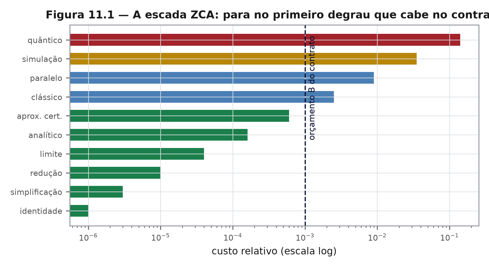

# Capítulo 11 — O algoritmo ZCA: a escada
*ZEPHIRUM — A Computação Antes da Execução | Parte III: A Arquitetura*

## 11.1 Nível 1 — Não se atravessa um rio de helicóptero

Para cruzar um rio, testa-se a ponte de pedra, depois a de madeira, depois o barco. O helicóptero existe, mas é último recurso, não primeiro impulso. A escada ZCA é essa sequência: do mais barato ao mais caro, com parada no primeiro degrau que satisfaz o contrato.

## 11.2 Nível 2 — Os dez degraus

1. **identidade** — a resposta é identidade algébrica conhecida;
2. **simplificação** — redução a forma menor;
3. **redução** — mapeamento para problema já resolvido;
4. **limite** — o caso assintótico fecha a pergunta;
5. **analítico** — forma fechada avaliável;
6. **aproximação certificada** — séries e cotas com erro garantido;
7. **clássico** — algoritmo usual, com a margem que o contrato aceita;
8. **paralelo** — o mesmo, distribuído;
9. **simulação** — modelo executado em máquina clássica, inclusive MPS [20] e mitigação [19];
10. **quântico** — processador quântico real [1, 2].

A regra de parada é uma linha:

$$ \text{suba o degrau mais baixo tal que } c(d) \le B \;\text{ e }\; \delta(d) \le \varepsilon $$

Se o degrau 1 resolve, os degraus 2 a 10 nunca existem. O quântico entra como consequência do contrato, nunca como presunção de prestígio.

## 11.3 Nível 3 — Por que a busca linear é ótima aqui

Se os degraus são ordenados por custo crescente, a busca linear devolve o mínimo viável: o primeiro que satisfaz é, por definição, o de menor custo entre os viáveis. A prova é imediata, e a condição é o que pode falhar: **a ordenação precisa ser verdadeira**.

Na prática, a ordenação não é universal. Um degrau "clássico" pode custar mais que uma simulação para problemas pequenos; uma identidade pode exigir verificação cara. Quando a ordenação se inverte, a busca linear devolve solução viável, mas não ótima. O sistema registra esse caso como `ordenacao_violada` no recibo, e o capítulo 15 o trata como limitação declarada.

## 11.4 Nível 2 — Exemplo com números

Pergunta: estimar a média de 10⁶ valores com erro relativo de 1%.

| Degrau | Custo (unid.) | Erro | Decisão |
|---|---|---|---|
| 5 analítico (média exata) | 1,0 | 0 | viável, mas não é o mais barato |
| 6 aproximação por amostragem (10⁴ pontos) | 0,01 | 0,5% | **viável e menor custo** |
| 7 clássico completo | 1,0 | 0 | viável |

O degrau 6 vence porque satisfaz $\varepsilon$ com custo menor. A escada não busca a resposta exata: busca a resposta **suficiente**, com prova de suficiência.

## Exercícios

1. Construa uma escada de cinco degraus para um problema da sua área e estime custos relativos.
2. Explique por que a busca linear deixa de ser ótima quando a ordenação é violada.
3. Um crítico afirma que a escada é apenas "tentar do barato ao caro". O que a distingue de uma tentativa informal?
