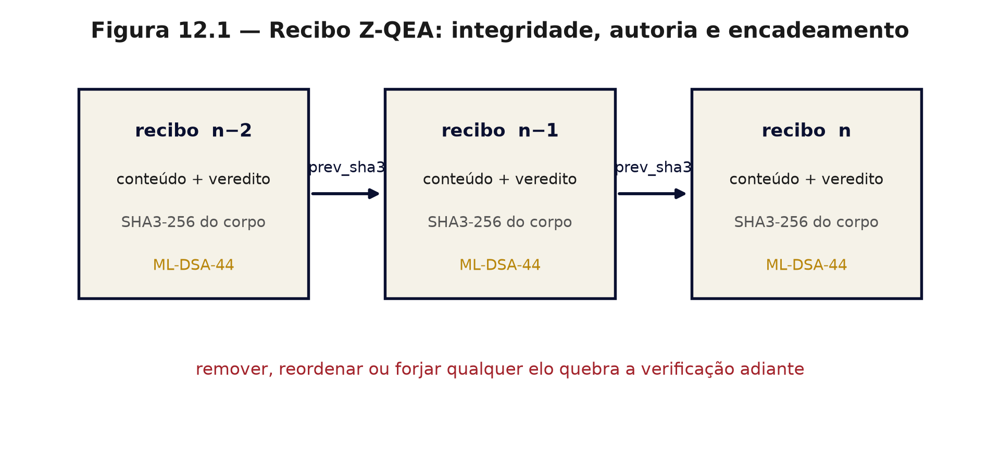

# Capítulo 12 — Certificados e recibo: gerador e verificador separados
*ZEPHIRUM — A Computação Antes da Execução | Parte III: A Arquitetura*

## 12.1 Nível 1 — O recibo que outra pessoa confere

Um recibo só vale quando outra pessoa consegue conferir. Aqui, quem gera o certificado é um programa; quem confere é outro, separado de propósito — como o caixa e o fiscal da loja.

## 12.2 Nível 2 — Anatomia do recibo

Cada decisão emite um objeto com quatro camadas de proteção:

| Camada | Mecanismo | O que garante | Norma |
|---|---|---|---|
| integridade | SHA3-256 do corpo canônico | o conteúdo não mudou | FIPS 202 [23] |
| encadeamento | campo `prev_sha3` | remoção e reordenação detectáveis | — |
| autoria | ML-DSA-44 | quem selou possuía a chave | FIPS 204 [25] |
| confidencialidade (opcional) | ML-KEM-768 | sigilo do conteúdo | FIPS 203 [24] |

O corpo canônico exclui os campos de assinatura e é serializado com ordenação de chaves, garantindo que dois programas produzam o mesmo hash para o mesmo conteúdo. Sem canonicalização, a assinatura seria frágil a diferenças de formatação.

## 12.3 Nível 2 — Os quatro ataques, e o resultado

A suíte adversarial do projeto executa ataques determinísticos contra o mecanismo [R4]. Resultado em 30/10/2026: **13 casos aprovados, 0 falhas, 1 alerta**.

| Ataque | Resultado | Mensagem do verificador |
|---|---|---|
| alterar o veredito e o TVD do recibo | rejeitado | assinatura inválida |
| remover um elo do meio da cadeia | detectado | elo 1: encadeamento quebrado |
| reordenar elos | detectado | elo 1: encadeamento quebrado |
| validar com chave pública alheia | rejeitado | assinatura inválida |

O alerta único é relevante e está declarado: a biblioteca `pqcrypto`, usada para ML-DSA-44, **não estava declarada** como dependência do pacote publicado, de modo que a assinatura falhava em instalação limpa. O defeito foi identificado pela própria suíte e corrigido como extra opcional `pqc`.

## 12.4 Nível 3 — A separação gerador/verificador

A separação segue a tradição de proof-carrying code [6] e dos sistemas de prova verificável: o certificado deve ser verificável em tempo muito menor que o de geração. Aqui, a assimetria é explícita: gerar exige executar o experimento; verificar exige recomputar um hash e conferir uma assinatura.

Três consequências de projeto:

1. um defeito no gerador não corrompe o verificador — o bug vira recusa, não aprovação silenciosa;
2. o verificador pode ser distribuído a terceiros, inclusive a um auditor cético;
3. o custo de auditoria é independente do custo do experimento.

## 12.5 O que o recibo não prova

O recibo prova integridade, encadeamento e posse de chave. **Não prova autoria no sentido jurídico**, não constitui certificação de conformidade FIPS do caminho próprio, e não substitui parecer de terceiro. A distinção importa: uma assinatura ML-DSA-44 válida demonstra que o selo foi produzido com a chave privada correspondente; não demonstra que o experimento foi bem desenhado.

Essa é a fronteira que o capítulo 15 explora, e é a razão de o livro chamar o mecanismo de **recibo verificável**, não de certificação.

## Exercícios

1. Por que a canonicalização do corpo é necessária para a assinatura funcionar entre implementações distintas?
2. Descreva o ataque de replay e explique por que o encadeamento o dificulta, sem eliminá-lo por completo.
3. Qual a diferença entre "assinatura válida" e "resultado confiável"? Dê um exemplo em que a primeira existe e a segunda não.
