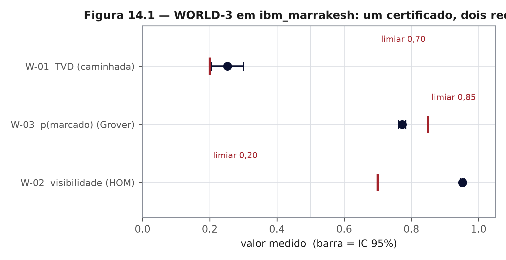
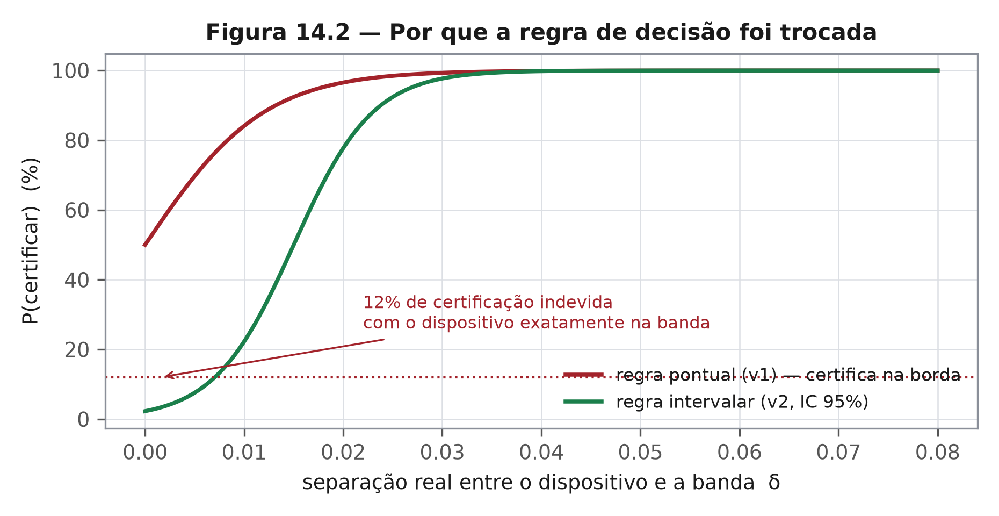

# Capítulo 14 — Experimentos: resultados honestos, inclusive os que doem
*ZEPHIRUM — A Computação Antes da Execução | Parte IV: O Teste*

## 14.1 Nível 1 — A hora de abrir os números

Um livro que só publica vitórias é panfleto. Este capítulo abre os números, incluindo os que contrariam a narrativa que o projeto gostaria de contar.

## 14.2 Nível 2 — O que rodou em hardware real

**CHSH em `ibm_marrakesh`.** $S = 2{,}07 \pm 0{,}12$ em 200 shots; simulação sem ruído: 2,76; veredito emitido: REFUSED. O hardware revelou, de passagem, um defeito de gramática na leitura de números negativos, que 58 testes de bancada não haviam detectado — corrigido em campo.

**WORLD-3.** Três protocolos independentes, 8.192 shots por job, bandas declaradas antes da execução.

| Protocolo | Medida | IC 95% | Banda declarada | Veredito |
|---|---|---|---|---|
| W-02 interferência de dois fótons (HOM [17]) | visibilidade 0,952 ± 0,001 | [0,947; 0,957] | ≥ 0,70 | **1 — certificado** |
| W-03 Grover 3 qubits [13] | p(marcado) 0,773 ± 0,011 | [0,764; 0,782] | ≥ 0,85 | REFUSED |
| W-01 caminhada quântica | TVD 0,253 ± 0,048 | [0,244; 0,263] | reprova acima de 0,20 | REFUSED |

A interferência de dois fótons medida em W-02 é o ingrediente físico da amostragem bosônica [18], o que situa o protocolo na fronteira entre demonstração de dispositivo e teste de complexidade.

O ponto metodológico mais importante do capítulo não é o 0,952: é a recusa do 0,773. A amplificação de Grover é visível — o valor supera com folga o 0,125 do palpite uniforme em três qubits —, mas 0,773 não alcança a banda de 0,85 que o protocolo exigia. Um sistema desonesto chamaria isso de sucesso parcial. Este chamou de recusa, e registrou o motivo.

## 14.3 Nível 2 — O erro estatístico que quase passou

A regra de decisão original comparava um valor pontual com a banda. Uma auditoria adversarial do desenho mostrou que, com o dispositivo exatamente sobre a banda, essa regra certificava em **12% das repetições**. O defeito não estava no hardware nem na linguagem: estava na estatística.

A correção foi trocar regra pontual por regra intervalar e refazer o cálculo de poder:

| Parâmetro | Regra nova |
|---|---|
| separação mínima detectável (K = 1) | δ = 0,0150 |
| separação mínima detectável (K = 2) | δ = 0,0212 |
| critério | intervalo de 95% inteiramente de um lado da banda |

Consequência declarada: W-03 permanece **não certificado** com a regra nova, e a banda W-01 é considerada inviável pelo número de shots necessário. Publicar isso custa credibilidade aparente e compra credibilidade real — que é o único tipo que sobrevive à auditoria de terceiro.

## 14.4 Nível 2 — Regressão e conformidade

| Bateria | Resultado | Data |
|---|---|---|
| regressão do núcleo | 58/58 | out. 2026 |
| bateria da família QASM | 12/12 | out. 2026 |
| compilador (programas válidos) | 8/8 | out. 2026 |
| verificador formal de circuitos | 4/4 | out. 2026 |
| conformidade OpenQASM 3 | 24/24 | 30/10/2026 |
| suíte adversarial de recibos | 13 PASS, 0 FAIL, 1 WARN | 30/10/2026 |

## 14.5 Nível 3 — Metodologia

Todo número deste capítulo está amarrado a um recibo com hash SHA3-256, assinatura ML-DSA-44 e as três métricas de sistema (capítulo 10). A regra editorial do livro é a mesma do sistema: número sem recibo não entra no texto, e resultado negativo entra com o mesmo peso do positivo.

As escolhas estatísticas poderiam ser outras: cotas de concentração como a de Hoeffding [28] dispensam suposição de normalidade e dariam intervalos mais largos; a reamostragem por bootstrap [30] estimaria a distribuição do estimador sem forma fechada. A opção por intervalos exatos de Clopper-Pearson [26] foi feita por conservadorismo, e está declarada.

Limite declarado desta seção: os experimentos foram desenhados e executados pelo próprio autor do sistema. Não há revisão por pares concluída, e o capítulo 15 trata isso como a principal fragilidade do conjunto.

## Exercícios

1. Por que publicar o 0,773 como recusa é mais defensável do que apresentá-lo como sucesso parcial?
2. Recalcule o intervalo de confiança de uma proporção com 8.192 shots e $p = 0{,}773$. O veredito muda?
3. A falha de 12% estava na estatística, não no hardware. Que lição isso traz para o desenho de experimentos quânticos?
