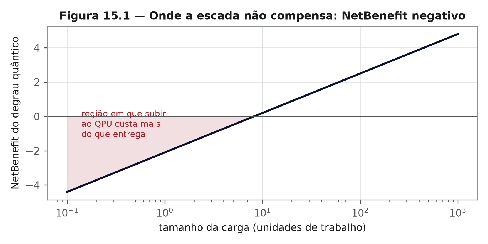

# Capítulo 15 — Limitações: onde a escada não compensa
*ZEPHIRUM — A Computação Antes da Execução | Parte IV: O Teste*

## 15.1 Nível 1 — O limite de jurisdição

Todo juiz tem limite de jurisdição. Este capítulo desenha a fronteira do que a linguagem promete — e é a parte do contrato que se lê antes de assinar.

## 15.2 Nível 2 — Quatro limitações estruturais

**Indecidibilidade.** Sem contrato, o juiz não existe: decidir necessidade no caso geral é o problema da parada [3]. O contrato $\varepsilon$–$B$–$M$ torna o problema decidível por construção, ao preço de restringir a jurisdição.

**Escassez de cotas inferiores.** Para afirmar "este é o degrau mais barato possível", seria preciso conhecer cotas inferiores de custo, que a teoria raramente entrega. A escada ordena custos conhecidos; não prova ausência de degrau mais barato desconhecido.

**Custo da análise.** O juiz consome recursos. Quando a análise custa mais que a execução, o NetBenefit fica negativo — e a Figura 15.1 mostra a região.

**Ordenação não universal.** A busca linear é ótima apenas se os degraus estão ordenados por custo. Quando a ordem se inverte, há solução viável, não ótima.

## 15.3 Nível 2 — A limitação que mais importa

O conjunto de evidências deste livro foi produzido por um único autor, sem revisão por pares concluída, sem usuário externo registrado e sem auditoria independente do desenho experimental. Isso não invalida os números; limita o que eles autorizam afirmar.

| Alegação | Situação | Base |
|---|---|---|
| recibos com SHA3 selando decisões | sustentada | capítulo 12, suíte adversarial |
| assinatura ML-DSA-44 do recibo | sustentada | `zqea_sig`, 8 testes |
| cadeia detecta remoção e reordenação | sustentada | suíte de 30/10/2026 |
| conformidade FIPS 204 **certificada** | **não sustentada** | não há certificação CAVP do caminho próprio |
| recibo aceito como prova regulatória | **não sustentada** | não existe norma que o reconheça |
| revisão por pares concluída | **não existe** | há preprint e registro em repositório |
| adoção por terceiros | **não existe** | nenhum usuário externo registrado |
| vantagem prática em escala industrial | **não demonstrada** | sem carga de produção |

A tabela é o resumo mais importante do livro. Ela separa o que foi construído do que se espera que seja construído, e é a razão de o capítulo 16 existir.

## 15.4 Nível 3 — Ameaças à validade, revisitadas

As cinco ameaças do capítulo 6 voltam aqui com peso maior. A validade externa é a mais frágil: os problemas testados são sintéticos, e a passagem para carga real de produção não foi medida. A validade de construto também merece atenção: "certificado válido" mede integridade e autoria, não correção do desenho experimental.

Uma terceira ameaça é específica deste projeto: o autor é também o verificador. A mitigação adotada foi separar gerador e verificador em processos distintos e publicar a suíte adversarial, mas ela não equivale a auditoria independente.

## 15.5 Quando não usar

Não se deve usar esta arquitetura quando: (i) a pergunta exige exatidão sem tolerância declarada; (ii) o custo da análise supera o da execução; (iii) não há meio de verificar o recibo por terceiro; (iv) o contexto exige certificação regulatória que o mecanismo não possui.

A lista é curta e específica de propósito. Uma limitação genérica ("pode não funcionar em todos os casos") não informa; a lista acima informa.

## Exercícios

1. Escolha um dos quatro itens de "quando não usar" e descreva um caso concreto que se enquadre nele.
2. Por que "não demonstrada" é uma classificação diferente de "falsa"? Use a tabela de alegações para responder.
3. Proponha um experimento que atacaria a validade externa deste livro.
